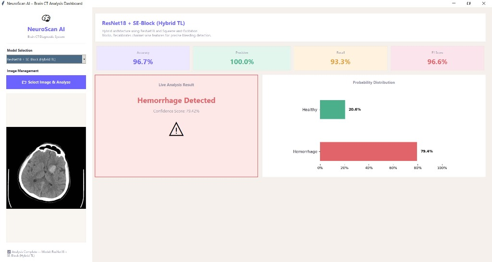
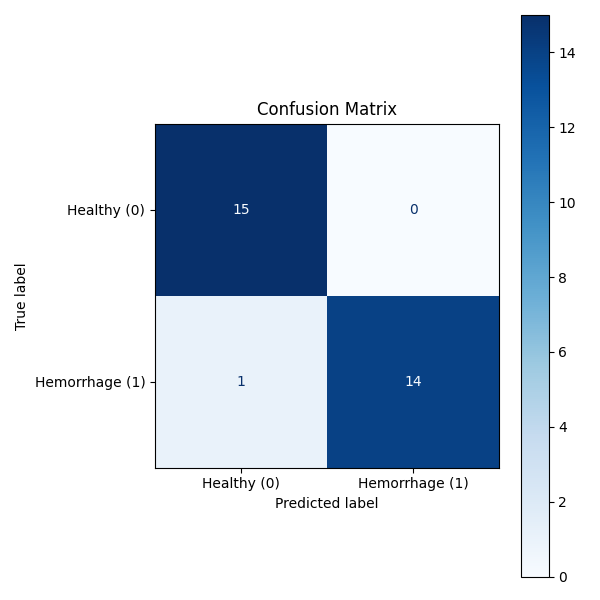
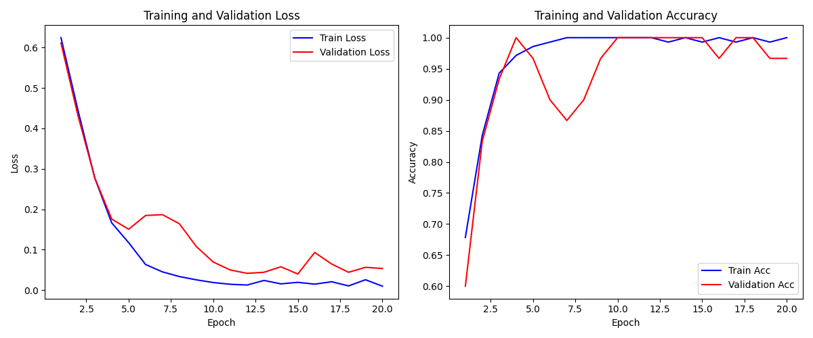

# 🧠 Brain Hemorrhage Detection System (NeuroScan AI)

[](https://www.python.org/)
[](https://pytorch.org/)
[](LICENSE)

**NeuroScan AI**, beyin Bilgisayarlı Tomografi (BT / CT) taramalarından otomatik olarak **Beyin Kanaması (Intracranial Hemorrhage)** tespiti yapan Derin Öğrenme (Deep Learning) tabanlı bir medikal teşhis ve analiz sistemidir.

Proje, kullanıcı dostu masaüstü arayüzü (GUI) ile klinik kararları desteklemek üzere tasarlanmış 2 adet gelişmiş Derin Öğrenme modelini içerir.

---

## 📸 Kullanıcı Arayüzü (GUI Screenshots)

Sistemin grafik kullanıcı arayüzü (NeuroScan AI Dashboard), doktorların ve araştırmacıların BT görüntülerini kolayca yükleyerek anlık tahmin ve olasılık dağılımlarını görselleştirmesine olanak tanır.

### NeuroScan AI Analysis Dashboard


*Görsel: Beyin CT görüntüsü yüklendiğinde modelin canlı analizi, güven skoru (Confidence Score: %79.42), Sağlıklı vs Kanama olasılık dağılımı ve model performans metrikleri.*

---

## ✨ Öne Çıkan Özellikler

- 🖥️ **Canlı Analiz Masaüstü Arayüzü (Tkinter GUI):**
  - Tek tıkla BT görüntüsü yükleme ve anında çıkarım (inference).
  - Canlı olasılık dağılım grafiği (Matplotlib entegreli).
  - Farklı modeller arasında anlık geçiş yapabilme yeteneği.
  - Pastel ve modern medikal tema tasarımı.
- 🧬 **İki Farklı Model Mimarisi:**
  - **ResNet18 + SE-Block (Hybrid Transfer Learning):** Squeeze-and-Excitation dikkat (attention) mekanizması ile kanal bazlı özellikleri yeniden kalibre eden hibrit mimari.
  - **Custom CNN V6 (Hafif ve Hızlı Mimari):** Özel olarak tasarlanmış, Spatial Dropout destekli ~1.2M parametreli hafif model.
- 📊 **Detaylı Performans Metrikleri & Görselleştirme:**
  - Konfüzyon matrisi (Confusion Matrix), ROC-AUC eğrileri ve eğitim/doğrulama grafik çıktıları.

---

## 📈 Model Performans Karşılaştırması

Sistemde eğitilen ve test verisi üzerinde değerlendirilen modellerin performans metrikleri aşağıda sunulmuştur:

| Model | Doğruluk (Accuracy) | Kesinlik (Precision) | Duyarlılık (Recall) | F1-Skoru | Parametre Sayısı |
| :--- | :---: | :---: | :---: | :---: | :---: |
| **ResNet18 + SE-Block** | **96.7%** | **100.0%** | **93.3%** | **96.6%** | ~11.2M |
| **Custom CNN V6** | **93.3%** | **93.3%** | **93.3%** | **93.3%** | ~1.2M |

### ResNet18 + SE-Block Eğitim Performansı & Konfüzyon Matrisi

| Konfüzyon Matrisi | Eğitim & Doğrulama Grafik Tablosu |
| :---: | :---: |
|  |  |

---

## 📁 Proje Dizin Yapısı

```
Brain_Hemorrhage_Detection/
├── assets/                          # Arayüz ve performans görselleri
│   ├── gui_dashboard.jpg
│   ├── resnet18_se_confusion_matrix.png
│   ├── resnet18_se_roc_curve.png
│   └── resnet18_se_training_graphs.png
├── outputs/                         # Model ağırlıkları ve test sonuçları
│   ├── resnet18_se/
│   │   ├── en_iyi_model.pth         # Eğitilmiş ResNet18+SE model dosyası
│   │   └── test_metrics.json
│   └── custom_cnn_v6/
│       ├── en_iyi_model.pth         # Eğitilmiş Custom CNN V6 model dosyası
│       └── test_metrics.json
├── src/                             # Kaynak kodlar ve mimari tanımları
│   ├── dataset.py                   # Veri kümesi yükleyici ve transformasyonlar
│   ├── trainer.py                   # Eğitim döngüsü ve kayıp fonksiyonları
│   ├── utils.py                     # Değerlendirme ve metrik hesaplama araçları
│   └── models/
│       ├── custom_cnn_v6.py         # Custom CNN V6 model mimarisi
│       └── resnet18_se.py           # ResNet18 + SE Block model mimarisi
├── brain_ct_gui.py                  # Grafik kullanıcı arayüzü uygulaması
├── train_resnet18_se.py             # ResNet18+SE model eğitim betiği
├── train_custom_cnn_v6.py           # Custom CNN V6 model eğitim betiği
├── requirements.txt                 # Gerekli kütüphaneler listesi
├── .gitignore                       # Git yoksayma kuralları
└── README.md                        # Proje dokümantasyonu
```

---

## 🛠️ Kurulum ve Çalıştırma

### 1. Gereksinimlerin Yüklenmesi
Projeyi bilgisayarınıza klonladıktan veya indirdikten sonra gerekli Python paketlerini yükleyin:

```bash
pip install -r requirements.txt
```

### 2. Masaüstü Arayüzünü Çalıştırma (GUI)
Görsel analiz ekranını başlatmak için terminalden şu komutu çalıştırın:

```bash
python brain_ct_gui.py
```

Arayüz açıldıktan sonra:
1. Üst kısımdaki açılır menüden kullanmak istediğiniz modeli seçin (**ResNet18 + SE-Block** veya **Custom CNN V6**).
2. **"Select Image & Analyze"** butonuna basarak bir BT (CT) beyin kesiti resmi seçin.
3. Sağ panelde anlık kanama/sağlıklı teşhisi ve olasılık dağılımını inceleyin.

### 3. Modelleri Yeniden Eğitme
Modelleri kendi veri setiniz üzerinde eğitmek isterseniz:

- **ResNet18 + SE-Block Eğitimi:**
  ```bash
  python train_resnet18_se.py
  ```
- **Custom CNN V6 Eğitimi:**
  ```bash
  python train_custom_cnn_v6.py
  ```

---

## 📦 Bağımlılıklar (requirements.txt)

- `torch >= 2.0.0`
- `torchvision >= 0.15.0`
- `numpy >= 1.20.0`
- `pandas >= 1.5.0`
- `opencv-python >= 4.5.0`
- `Pillow >= 9.0.0`
- `scikit-learn >= 1.0.0`
- `matplotlib >= 3.5.0`

---

## 📄 Lisans
Bu proje eğitim ve araştırma amaçlı geliştirilmiştir. MIT Lisansı altında açık kaynak olarak sunulmaktadır.
